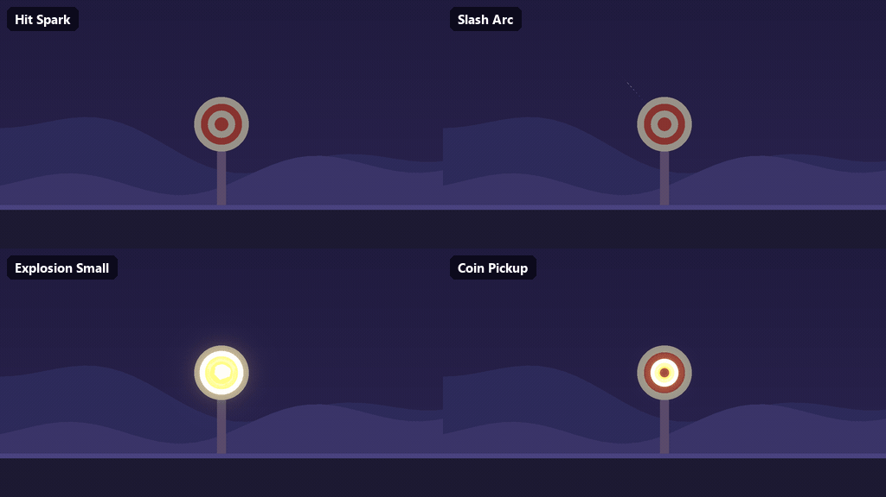

# Stylized 2D VFX Lite

Four drop-in 2D effects for Godot 4: hit spark, slash arc, small explosion and coin pickup. The shapes are drawn by `canvas_item` shaders and `GPUParticles2D`, so they stay sharp at any size and need no sprite sheets. Recolour any effect with one `tint` property.



Made by [REEBOO Labs](https://reeboolabs.com/). MIT licensed.

## The 4 effects

| Scene | What it is |
| --- | --- |
| `hit_spark.tscn` | Light hit: white-gold flash with a plus twinkle, thin ring, fast sparks |
| `slash_arc.tscn` | Quick sword slash: steel-blue crescent with a hot edge and a stringy tail |
| `explosion_small.tscn` | Small explosion: white flash, toon fireball, lingering smoke, shockwave, embers |
| `coin_pickup.tscn` | Coin pickup: gold ring, plus twinkle, rising glints and a gold dot burst |

## Install

**From the Godot Asset Library:** open the AssetLib tab in the editor, search for "Stylized 2D VFX Lite", download and install. The effects land in `addons/reeboo_fx2d/`.

**From GitHub:** copy the `addons/reeboo_fx2d/` folder into your project. No plugin needs enabling: the effects are plain scenes.

Needs Godot 4.4 or newer (tested with 4.4.1, 2D). Works with the Forward+, Mobile and Compatibility renderers.

## Usage

```gdscript
const HIT := preload("res://addons/reeboo_fx2d/effects/hit_spark.tscn")
var fx := ReebooFx2D.spawn(HIT, self, global_position)  # frees itself when done
fx.impact.connect(func(strength: float) -> void: print("shake the camera by ", strength))
```

To recolour or flip an effect, instantiate it yourself: `var fx2 := HIT.instantiate() as ReebooFx2D`, set `fx2.tint` or `fx2.scale.x = -1.0`, then `add_child(fx2)`. Slashes point to the right.

`ReebooFx2D` exposes `autoplay`, `free_when_done`, `speed`, `tint`, `play()`, `stop()`, `is_playing()` and the signals `impact(strength)` and `finished`.

## Demo and tests

Open this repository as a project in Godot and press F5 for the demo (Left/Right browse, Space replay, click to spawn at the mouse, T tint, B background, F flip, A auto-play). The demo and tests are not part of the AssetLib download.

Headless checks (run the import once first on a fresh checkout):

```
godot --headless --path . --import
godot --headless --path . -s res://tests/smoke_test.gd
godot --headless --path . -s res://tests/readme_snippets_test.gd
```

## More effects

The full Stylized 2D VFX pack has 26 effects: https://reeboolabs.itch.io/stylized-2d-vfx-godot

More from REEBOO Labs: https://reeboolabs.com/

## License

[MIT](LICENSE), Copyright (c) 2026 REEBOO Labs. This licence covers the files in this repository only. The paid pack is a separate product with its own licence.
